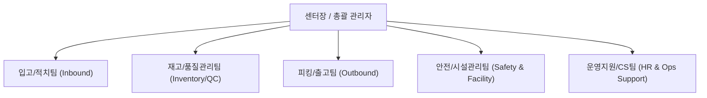
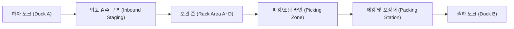

# [온보딩 01] 회사 소개 및 물류센터 개요

> **환영합니다!** 본 문서는 신규 입사자가 물류센터의 운영 구조와 환경을 빠르고 정확하게 이해할 수 있도록 돕는 온보딩 기본 가이드입니다.

---

## 1. 센터 미션 및 비전

당사 물류센터는 고객과의 신뢰를 연결하는 핵심 허브로서 빠르고 정확한 풀필먼트(Fulfillment) 서비스를 제공합니다.

- **정확성 (Accuracy)**: 오피킹·오배송 제로(0%) 지향
- **신속성 (Speed)**: 주문 마감시간(Cut-off) 준수 및 당일 출고 원칙
- **안전성 (Safety)**: 근로자의 안전이 최고의 생산성이라는 원칙 준수

---

## 2. 물류센터 조직 및 부서별 역할

센터는 상호 유기적으로 연결된 5개 핵심 팀으로 구성되어 있습니다.

| 부서 | 주요 업무 | 협업 부서 |
| :--- | :--- | :--- |
| **입고팀 (IB)** | 입하 하차, 수량/외관 검수, 바코드 라벨링, 랙 적치(Putaway) | 재고관리팀, 품질관리팀 |
| **재고관리팀 (ICQA)** | 일일 재고실사(Cycle Count), 불량/반품 격리, 로케이션 최적화 | 입고팀, 출고팀 |
| **출고팀 (OB)** | 주문 할당, 존/토트 피킹, 검수/패킹, 송장 부착, 도크 상차 | 배송사, CS팀 |
| **안전/시설팀** | 작업장 안전점검, 컨베이어/지게차 설비 유지보수, 소방 점검 | 전 부서 |
| **운영지원팀** | 근태 관리, 인력 배치, 비품 지급, 신규 입사자 교육 지원 | 전 부서 |

---

## 3. 센터 층별 및 구역(Zone) 배치도

센터는 물류 흐름(Flow)이 교차하지 않도록 단방향 동선(One-way System)을 기본으로 설계되었습니다.

### 구역별 상세 안내
- **Dock A (입고 도크)**: 윙바디, 탑차 입하 및 파렛트 단위 하차장
- **Zone A~B (고빈도 피킹존)**: 회전율이 높은 인기 상품 랙 (출고 작업대 인접)
- **Zone C~D (중·저빈도 보관존)**: 대용량 벌크 재고 및 하이랙(High Rack) 구역
- **Zone E (특수 보관존)**: 온·습도 관리 구역 및 고가품 보관실 (출입제한)
- **Dock B (출고 도크)**: 택배사 간선차량 접안 및 파렛트 랩핑 출하 구역

---

## 4. 근무 체계 및 교대근무 안내

물류센터는 365일 원활한 배송을 위해 조별 교대 근무를 운영합니다.

| 조 명칭 | 근무 시간 | 휴게 및 식사 시간 | 주요 업무 포커스 |
| :--- | :--- | :--- | :--- |
| **주간조 (Day Shift)** | 08:30 ~ 17:30 | 점심: 12:00~13:00 / 휴게: 15:00~15:20 | 대규모 입하 검수 및 B2B 대량 출고 |
| **오후조 (Mid Shift)** | 13:00 ~ 22:00 | 저녁: 17:30~18:30 / 휴게: 20:00~20:20 | B2C 이커머스 당일 주문 집중 피킹·패킹 |
| **심야조 (Night Shift)** | 22:00 ~ 익일 07:00 | 식사: 02:00~03:00 / 휴게: 05:00~05:20 | 새벽배송 마감분 상차 및 재고 이송/정리 |

> [!NOTE]
> 휴게시간은 센터 물량 상황 및 라인별 순환 운영 방식에 따라 10~15분 단위로 탄력 조정될 수 있습니다.

---

## 5. 기본 근무 수칙

1. **지정된 유니폼 및 보호구 착용**: 안전화, 안전조끼는 현장 출입 전 필수 착용입니다.
2. **사원증 패용**: 센터 내 이동 시 반드시 사원증을 목걸이 또는 가슴 포켓에 패용합니다.
3. **지정된 통행로 이용**: 바닥의 녹색 보행자 전용 도로(Green Walkway)로만 보행해야 합니다.
4. **휴대폰 사용 제한**: 작업 구역 내에서는 보행 중 스마트폰 사용이 엄격히 금지됩니다 (지정된 휴게실 이용).
5. **물류 자산 취급 주의**: 핸드자키, PDA 스캐너 등 공용 자재는 사용 후 제자리 반납 및 충전 포트에 거치합니다.
