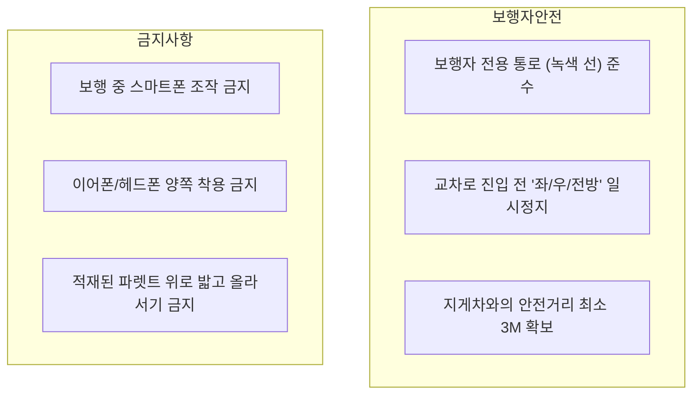
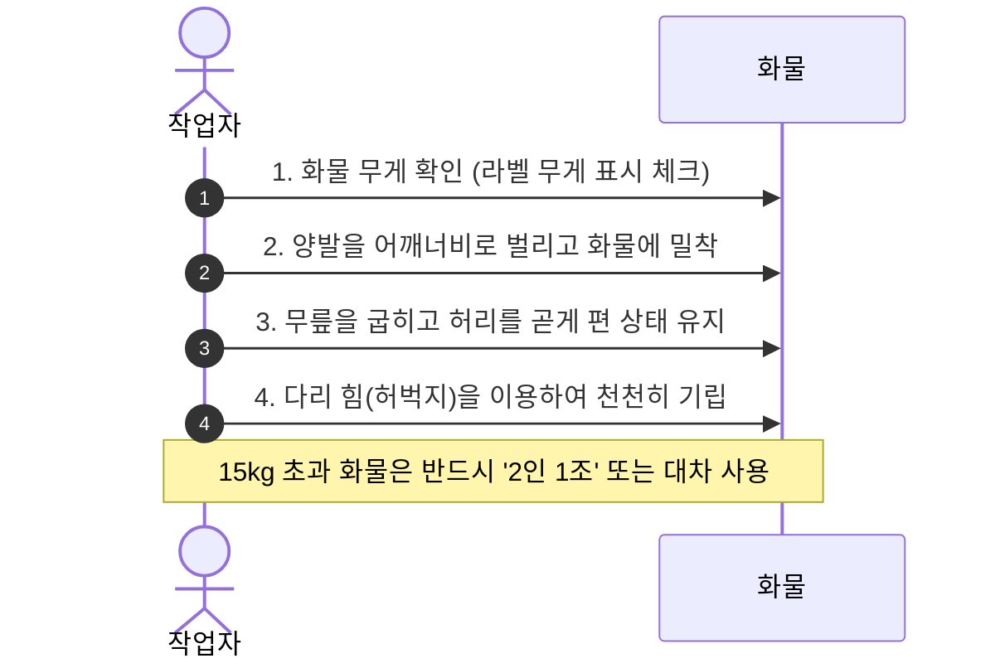

# [온보딩 02] 안전관리 및 보안수칙

> **안전 제1주의 (Safety First)**: 물류 현장의 안전은 타협할 수 없는 절대 원칙입니다. 안전수칙을 지키지 않으면 본인뿐 아니라 동료의 생명을 위협할 수 있습니다.

---

## 1. 개인보호구(PPE: Personal Protective Equipment) 규정

현장 진입 시 다음 보호구를 반드시 착용해야 하며, 미착용 시 작업장 출입이 제한됩니다.

| 보호구 | 필수 여부 | 착용 위치 / 규격 | 교체 및 지급 안내 |
| :--- | :---: | :--- | :--- |
| **안전화** | **필수** | 스틸토/복합소재 선심 장착 (발가락 보호) | 입사 시 1켤레 지급, 6개월 주기 교체 |
| **고시인성 조끼** | **필수** | 형광 반사 조끼 (지게차 운전자 시야 확보) | 입사 시 2벌 지급 |
| **작업 장갑** | **필수** | NBR 코팅 장갑 또는 절단 방지 장갑 | 현장 비품함에서 주 1회 수령 |
| **안전모** | 구역별 필수 | 하이랙 적치구역, 화물 하차 도크, 크레인 하부 | 도크 및 랙 진입로 거치대 비치 |
| **귀마개/마스크** | 선택/권장 | 소음 발생 기계 주변 및 분진 발생 포장 구역 | 보건관리실 상시 비치 |

> [!WARNING]
> 슬리퍼, 샌들, 굽 높은 신발, 헐렁한 의류(소매, 밑단 늘어짐) 및 긴 목걸이 착용은 회전 기계 끼임 및 낙하 충격 위험으로 금지됩니다.

---

## 2. 현장 보행 및 장비 교행 수칙

물류센터는 지게차, 무인지게차(AGV), 오더피커 등 중장비가 상시 운행되는 공간입니다.

### 지게차 작업 반경 안전 원칙
1. **아이컨택 (Eye-Contact) 원칙**: 지게차가 접근 시 운전자와 시선을 맞추고, 운전자가 손짓으로 정지 신호를 줄 때까지 기다립니다.
2. **사각지대 인지**: 마스트(지게차 앞 기둥)와 적재 화물로 인해 운전자의 전방 시야가 차단될 수 있음을 항상 유의합니다.
3. **블라인드 코너 경적**: 코너를 돌기 전 볼록거울을 확인하고, 발걸음을 늦춥니다.

---

## 3. 컨베이어 및 설비 비상정지(E-STOP) 사용법

컨베이어 벨트나 자동 소터(Sorter) 라인 작업자는 비상스위치 위치를 숙지해야 합니다.

1. **끼임 사고 발생 시 즉시 조치**:
   - 빨간색 버섯 모양의 **비상정지 버튼(E-Stop)**을 즉각 손바닥으로 강하게 누릅니다.
   - 와이어형 풀코드 스위치(Pull-cord Switch)가 설치된 라인은 라인을 몸 쪽으로 강하게 당깁니다.
2. **절대 금지 행위**:
   - 가동 중인 컨베이어 벨트를 타 넘어가거나 기어 들어가는 행위
   - 잼(Jam: 상품 걸림) 발생 시 가동 상태에서 손을 넣어 화물을 꺼내는 행위 (반드시 라인 정지 후 전용 훅 사용)

---

## 4. 중량물 취급 및 요통 예방 가이드

- **중량 한도 기준**:
  - 단독 취급 권장 무게: 남성 20kg 이하, 여성 15kg 이하
  - 20kg 초과 화물: **[중량물 주의]** 라벨 부착 품목으로 반드시 동료와 2인 1조로 리프팅

---

## 5. 비상 대응 및 화재 대피 절차

### 화재 발생 시 단계별 행동 요령
1. **발견 및 전파**: "불이야!"를 큰 소리로 외치고, 인근 벽면의 **화재경보기(발신기)** 버튼을 누릅니다.
2. **초기 진화**: 불길이 무릎 높이 이하일 경우 인근 ABC 분말소화기를 사용하여 바람을 등지고 방사합니다.
3. **신속 대피**: 불길이 번진 경우 연기를 마시지 않도록 젖은 물수건(또는 옷)으로 코와 입을 막고 자세를 낮춰 초록색 유도등을 따라 비상구로 대피합니다.
4. **집결지 이동**: 센터 밖 제1야외집결지(대형 주차장)로 집결하여 조장에게 인원 점검(Roll-call)을 받습니다.

### 센터 비상 연락망
- **종합방재실 (24시간)**: 내선 1199 / 직통 02-XXX-1119
- **안전관리팀장**: 010-XXXX-XXXX
- **보건관리실 (간호사 상주)**: 내선 1120

---

## 6. 센터 출입 및 보안 규정

1. **출입증 관리**: 출입 게이트(스피드게이트) 통과 시 1인 1태그 원칙을 준수합니다 (대리 태그 엄금).
2. **반입 제한 물품**:
   - 칼, 라이터, 인화성 물질, 가위 등 비인가 도구 (센터 지급용 안전칼만 사용 가능)
   - 개인 배낭/가방 (보관함에 보관 후 투명 비닐 파우치만 작업장 반입 허용)
3. **보안 검색대 운영**: 퇴근 시 무작위 소지품 검사 및 금속탐지기 게이트를 통과해야 합니다.
