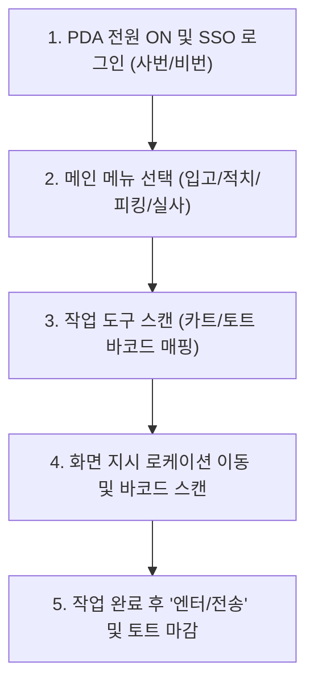

# [온보딩 03] 물류 기본 용어 및 시스템 가이드

> **소통의 시작**: 물류센터에서는 축약어와 전문 용어가 일상적으로 사용됩니다. 원활한 작업과 시스템 조작을 위해 핵심 용어와 WMS/PDA 사용법을 반드시 숙지해 주시기 바랍니다.

---

## 1. 물류 필수 용어 사전

| 용어 | 영문 / 풀이 | 의미 및 현장 설명 |
| :--- | :--- | :--- |
| **SKU** | Stock Keeping Unit | 상품 관리 최소 단위. 바코드(단품) 기준으로 색상, 사이즈가 다르면 다른 SKU임. |
| **LPN** | License Plate Number | 파렛트, 토트, 박스 단위에 부여되는 고유 추적 번호(주민등록번호 역할). |
| **ASN** | Advanced Shipping Notice | 사전 입고 예정 통보서. 납품업체가 어떤 상품을 몇 개 보낼지 미리 등록한 데이터. |
| **WMS** | Warehouse Management System | 창고관리시스템. 입고, 적치, 재고, 피킹, 출고 등 물류창고 전 과정을 제어하는 전산. |
| **WCS / WES** | Warehouse Control / Execution System | 컨베이어, 오토스토어, 소터 등 자동화 설비를 제어하고 작업을 지시하는 시스템. |
| **FIFO** | First In, First Out (선입선출) | 먼저 입고된 상품을 먼저 출고하여 재고 노후화 및 유통기한 경과를 방지하는 원칙. |
| **Tote (토트)** | Tote Box | 피킹된 상품을 담아 포장 구역으로 이동시킬 때 사용하는 플라스틱 바구니. |
| **Pallet (파렛트)** | 표준 11형 (1100×1100mm) | 대량 화물을 적재하여 지게차나 핸드자키로 한 번에 이동하기 위한 화물 받침대. |
| **Dock (도크)** | Loading / Unloading Dock | 화물 트럭이 후진으로 접안하여 상하차 작업을 진행하는 구역. |
| **Shortage (쇼트)** | 미출 / 품절 | 전산상 재고는 존재하나, 피킹 위치에 실물이 없어 피킹하지 못하는 상태. |

---

## 2. 로케이션(Location) 바코드 체계 이해

물류센터의 모든 보관 위치는 주소 체계처럼 규칙적으로 번호가 매겨져 있습니다.

### 로케이션 코드 구조 예시: `A-03-02-1`

```
       A     -     03     -     02     -     1
    [Zone]       [Aisle]       [Bay]       [Level]
    A 구역        3번 통로       2번 랙 기둥    1단 (바닥)
```

1. **Zone (구역)**: 알파벳으로 대분류 (A, B, C...)
2. **Aisle (통로/열)**: 통로 번호 (01, 02, 03... 통상 홀수/짝수로 좌우 구분)
3. **Bay (베이/기둥 연)**: 통로 진입 후 기둥 번호 (입구 기준 01부터 순차 증가)
4. **Level (단/층)**: 높이 단수 (1단 = 바닥층, 2단 = 2번째 층선반, 3단...)

> [!TIP]
> 피킹 및 적치 시 반드시 **로케이션 바코드를 먼저 스캔**하고, 그 후 **상품 바코드를 스캔**해야 WMS 시스템에서 오작업 오류를 방지할 수 있습니다.

---

## 3. PDA 스캐너 기본 사용법

작업자는 개인별로 배정된 핸드헬드 터미널(PDA)을 사용하여 작업을 처리합니다.



### PDA 조작 핵심 요령
- **바코드 스캔 각도**: 스캐너 레이저 빔을 바코드와 직각(90도)으로 맞추기보다, 약간 비스듬히(약 15도) 기울여 스캔하면 반사로 인한 인식 오류를 줄일 수 있습니다.
- **알림음(Beep) 확인 습관**:
  - **'삑' (단음, 녹색 LED)**: 정상 인식 (Pass)
  - **'삐-비-빅' (연속음/진동, 적색 LED)**: 에러 발생 (바코드 불일치, 수량 초과 등 WMS 오류 메시지 즉시 확인 필요)
- **배터리 관리**: 배터리 잔량이 20% 이하로 떨어지면 대기 구역의 완충 배터리로 신속히 교체합니다.

---

## 4. 물류 기본 작업 도구 가이드

| 도구명 | 용도 | 사용 시 주의사항 |
| :--- | :--- | :--- |
| **핸드 파렛트 트럭 (핸드자키)** | 1~2톤 이하 파렛트 화물 근거리 수동 이송 | 경사로 진입 금지, 사람 탑승 금지, 이동 시에는 화물을 당기지 말고 밀면서 이동 원칙 |
| **롤테이너 (Roll-tainer)** | 박스 단위 소화물 대량 이동용 바퀴 케이지 | 3단 적재 초과 금지, 바퀴 잠금장치(Stopper) 작동 확인 후 상하차 |
| **안전칼 (Safety Cutter)** | 박스 개봉 및 랩 커팅 전용 | 칼날 자동 복귀형 안전칼만 사용 가능 (일반 문구용 커터칼 현장 반입 금지) |
| **피킹 카트 (Picking Cart)** | 여러 개의 토트를 싣고 다품종 소량 피킹 | 통로 중앙 정차 금지, 바닥 요철 통과 시 서행 |
