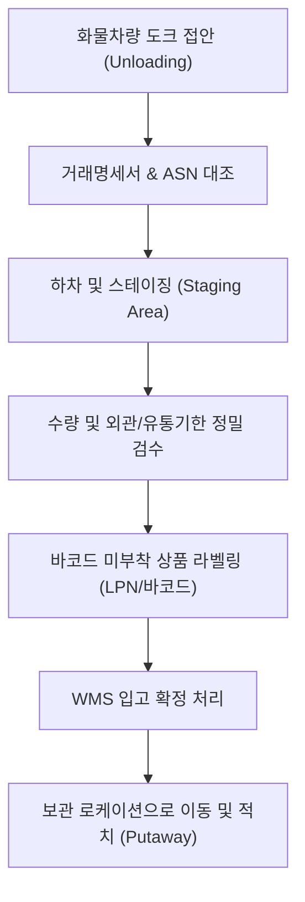

# [온보딩 04] 입고 및 적치 매뉴얼 (Inbound & Putaway)

> **물류 흐름의 첫 단추**: 입고(Inbound)는 상품이 물류센터에 반입되어 정확한 재고로 등록되는 핵심 프로세스입니다. 입고 시점의 오류는 피킹, 출고, 재고 오차로 직결되므로 철저한 검수와 정확한 적치가 요구됩니다.

---

## 1. 입고 전체 프로세스 개요

---

## 2. 하차 및 1차 검수 (Receiving)

1. **차량 접안 및 안전 조치**:
   - 화물차량이 도크에 완전 정지 후 휠초크(차륜 고임목)가 설치되었는지 확인합니다.
   - 도크 레벨러(Dock Leveler)를 차량 적재함 높이에 맞추어 안전판을 거치합니다.
2. **서류 대조**:
   - 공급사 운송장/거래명세서의 공급업체명, PO(발주번호) 번호, 박스/파렛트 총 수량을 실물과 대조합니다.
3. **하차 작업**:
   - 지게차 또는 전동 파렛트 트럭으로 파렛트를 하차하여 입고 대기 구역(Inbound Staging)에 정렬합니다.
   - 파렛트 간 최소 50cm 통로를 유지하여 검수자가 사방에서 확인할 수 있도록 배치합니다.

---

## 3. 정밀 검수 및 라벨링 (Inspection & Labeling)

### 필수 검수 체크리스트
- [ ] **수량 일치**: 발주 수량(ASN)과 실제 개봉 검수 수량이 정확히 일치하는가?
- [ ] **파손 확인**: 외관 박스 터짐, 테이프 개봉 흔적, 내부 내용물 누수 여부가 없는가?
- [ ] **유통기한/제조일자**: 당사 입고 기준 잔여 유효기간(통상 총 유효기간의 70% 이상)을 충족하는가?
- [ ] **바코드 스캔 테스트**: 출력된 바코드 또는 기존 바코드가 PDA 스캐너로 1회에 정상 리딩되는가?

---

## 4. 예외(Inbound Exception) 상황 대응 기준

| 발생 상황 | 현장 대응 조치 | 보고 및 전산 처리 |
| :--- | :--- | :--- |
| **과입고 (Over Delivery)** | 발주 수량을 초과한 수량은 즉시 별도 파렛트로 분리 | WMS상 실입고 수량 입력 전 입고 관리자 승인 득함 |
| **오입고 (Wrong SKU)** | 발주되지 않은 다른 품목 반입 시 즉시 하차 중단 | 공급업체 통보 및 반송(RTV) 대기 구역으로 이동 |
| **파손품 (Damaged)** | 파손 부위 사진 3장(전체, 송장, 파손부위) 촬영 | [HOLD/불량] 라벨 부착 후 격리 구역 적치 |
| **유통기한 임박** | 기준 일수 미달 상품 발견 시 검수 중단 | 바이어(MD) 확인 요청 및 승인 전까지 입고 보류 |

---

## 5. 적치 (Putaway) 작업 절차

검수가 완료된 상품은 재고로 판매 가능 상태로 만들기 위해 보관 랙으로 이동 및 적치합니다.

### PDA 적치 단계별 조작
1. **PDA 메뉴 진입**: `[입고] -> [적치(Putaway)]` 선택
2. **이동 대상 바코드 스캔**: 파렛트 LPN 또는 상품 바코드 스캔
3. **추천 로케이션 확인**: PDA 화면에 표시되는 목적지 로케이션(예: `B-04-03-2`) 확인
4. **목적지 이동 및 로케이션 스캔**: 해당 랙에 도착하여 랙 기둥의 로케이션 바코드를 먼저 스캔
5. **상품 안치 및 수량 확인**: 상품을 랙에 안전하게 밀어 넣고, 실물 적치 수량을 입력하여 확정

> [!IMPORTANT]
> - **허용 하중 준수**: 랙 선반 라벨에 명시된 단당 최대 하중(예: Max 1,000kg)을 절대 초과하여 적재하지 마십시오.
> - **돌출 방지**: 통로 쪽으로 파렛트나 박스가 10cm 이상 튀어나오면 지게차 주행 시 충돌 추락의 원인이 됩니다. 반드시 랙 프레임 안쪽으로 완벽히 밀어 넣으십시오.
> - **임의 로케이션 적치 금지**: 추천 로케이션이 꽉 차서 들어가지 않는 경우, PDA에서 `로케이션 변경` 사유를 입력하고 관리자에게 신규 빈 로케이션(Empty Location)을 배정받아야 합니다.
