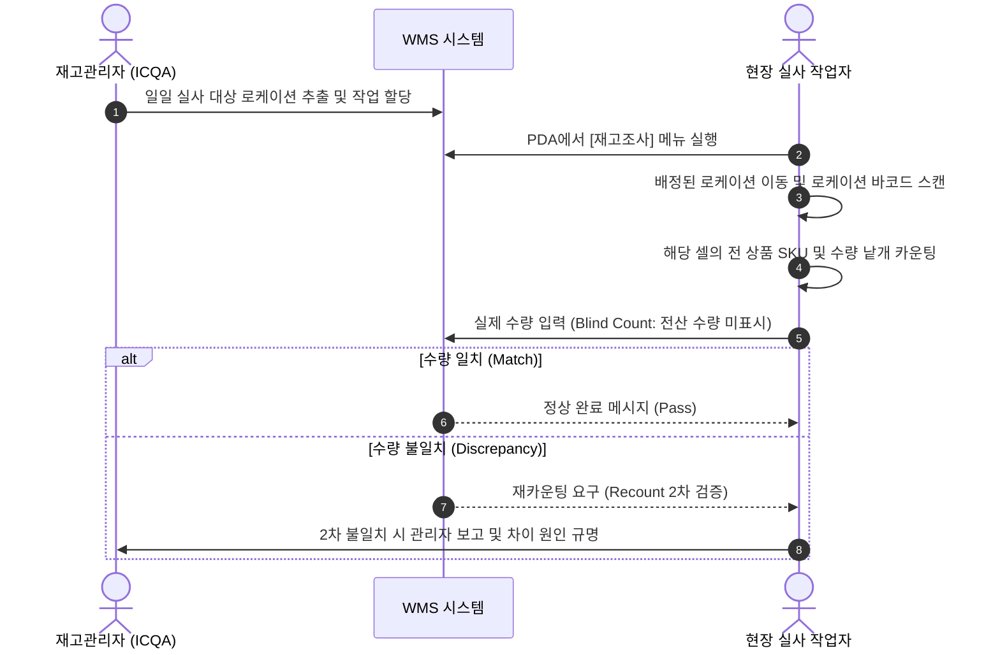
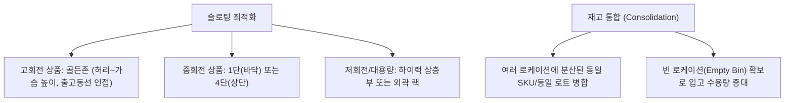

# [온보딩 05] 재고관리 및 보관규정 (Inventory Management)

> **재고는 회사의 자산입니다**: 장부 재고(WMS)와 실물 재고(Physical Stock)가 정확히 일치해야 고객 약속(출고)을 지킬 수 있습니다. 재고 오차는 곧 고객 클레임과 손실로 연결됩니다.

---

## 1. 재고관리의 3대 핵심 원칙

1. **재고 정확도(IRA: Inventory Record Accuracy) 99.8% 달성**:
   - $\text{IRA} = \left( 1 - \frac{|\text{전산재고} - \text{실물재고}|}{\text{전산재고}} \right) \times 100$
2. **선입선출(FIFO / FEFO) 엄수**:
   - 유통기한이 존재하는 품목은 **선유통기한 만료 우선(FEFO: First Expired, First Out)**을 절대 적용합니다.
3. **무단 이동 절대 금지 (Scan First, Move Later)**:
   - PDA 스캔을 통하지 않은 채 실물을 다른 선반이나 파렛트로 1박스라도 옮겨서는 안 됩니다.

---

## 2. 재고실사 (Cycle Count) 프로세스

센터에서는 전면 가동 중단 없이 매일 구역별로 순환 재고실사(Cycle Count)를 수행합니다.

### 블라인드 카운트(Blind Count)의 중요성
- PDA 화면에 시스템 수량을 미리 보여주지 않고 현장 실물 수량을 직접 세어 입력하게 함으로써, 작업자의 예단이나 형식적 카운팅을 방지합니다.

---

## 3. 로케이션 유지보수 및 슬로팅(Slotting)

재고를 효율적으로 보관하고 피킹 생산성을 극대화하기 위한 관리 작업입니다.

---

## 4. 유효기간(Shelf-life) 및 품질 관리

- **유효기간 신호등 관리 체계**:
  - 🟢 **정상 (초록)**: 유효기간 잔여 50% 이상 $\rightarrow$ 일반 피킹 로케이션 보관
  - 🟡 **주의 (노랑)**: 유효기간 잔여 30%~50% $\rightarrow$ 최우선 출고 랙 전진 배치
  - 🔴 **출고불가/폐기 (빨강)**: 유효기간 잔여 30% 미만 $\rightarrow$ 즉시 시스템상 [HOLD] 처리 후 폐기구역 이동

> [!CAUTION]
> 온습도 관리 대상 상품(콜드체인, 화장품, 건강기능식품 등)은 지정된 정온/냉장 구역 밖으로 30분 이상 방치되어서는 안 됩니다.

---

## 5. 파손품(Damaged) 및 재고 조정 절차

작업 중 상품이 낙하, 훼손되었거나 전산과 실물의 차이를 발견한 경우:

1. **현장 즉시 격리**: 파손된 상품을 바닥이나 정상 선반에 두지 말고 노란색 **[파손/격리품 전용 박스]**에 담습니다.
2. **PDA 상태 변경**: `[재고 이동] -> [상태 변경: 정상 -> 불량/파손]` 처리합니다.
3. **재고 조정(Adjustment) 금지 원칙**:
   - 일반 작업자는 전산 재고를 임의로 폐기(`-`)하거나 생성(`+`)할 수 없습니다.
   - 재고 조정은 반드시 ICQA 파트장 또는 센터 총괄 관리자의 사유 조사(CCTV 확인, 입출고 이력 추적) 및 최종 승인을 통해서만 반영됩니다.
