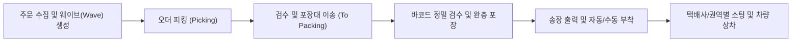
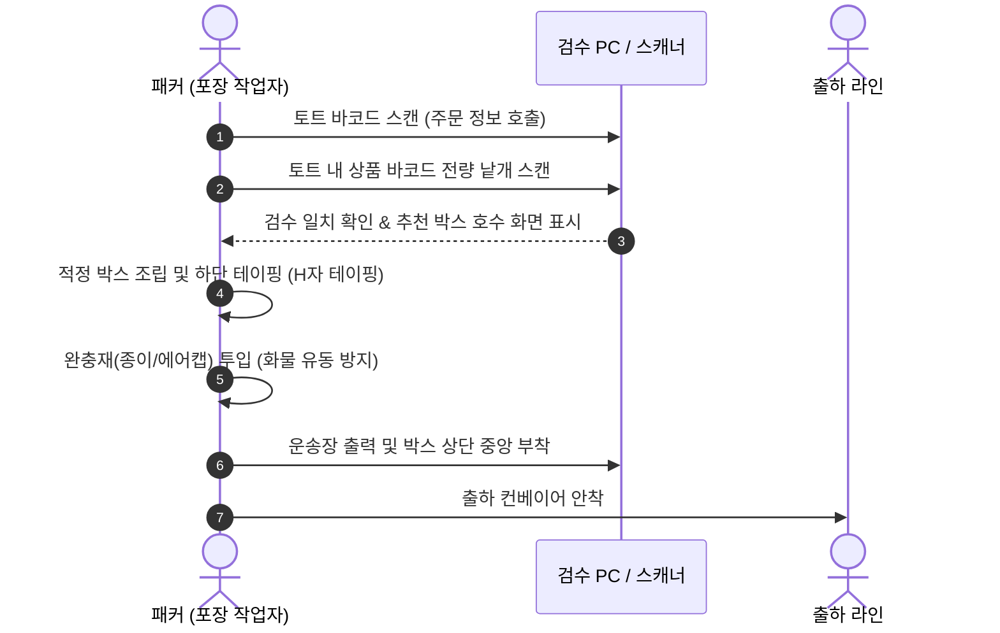

# [온보딩 06] 피킹, 패킹 및 출고 매뉴얼 (Outbound & Shipping)

> **고객과 만나는 마지막 관문**: 출고(Outbound)는 고객이 주문한 상품을 찾아(피킹), 안전하게 포장(패킹)하여, 약속된 차량에 상차(출하)하는 핵심 실행 단계입니다.

---

## 1. 출고 전체 프로세스

---

## 2. 피킹(Picking) 방식 및 작업 절차

센터에서는 주문 유형에 따라 최적의 피킹 전략을 운영합니다.

| 피킹 유형 | 대상 주문 | 작업 특징 및 방식 |
| :--- | :--- | :--- |
| **단품 단수 (Single-item)** | 1개 품목 1개 주문 | 카트에 토트 여러 개를 싣고 동선 최단 경로를 따라 대량 피킹 |
| **다품종 합포장 (Multi-order)** | 여러 품목 묶음 주문 | PDA 지시에 따라 1개 토트에 1개 주문씩 매핑하여 분할 피킹 |
| **배치/토탈 피킹 (Batch Picking)** | 특정 이벤트 대량 주문 | 전체 수량을 한 번에 벌크로 피킹 후 DAS(소팅 설비)에서 분류 |

### PDA 피킹 표준 작업 순서
1. **작업 할당**: PDA `[출고] -> [오더 피킹]` 진입 후 작업 그룹(Batch) 바코드 스캔
2. **토트 매핑**: 사용할 토트 바코드를 스캔하여 장바구니 생성
3. **로케이션 이동**: PDA가 안내하는 최적 동선의 첫 번째 로케이션으로 이동
4. **로케이션 바코드 스캔**: 선반의 위치 바코드 스캔 (오로케이션 방지)
5. **상품 바코드 스캔**: 실물 상품 바코드 낱개 스캔 (외관 불량 유무 동시 육안 점검)
6. **토트 투입 및 완료**: 지시 수량만큼 토트에 담고 피킹 마감 후 포장 구역 컨베이어에 투입

> [!WARNING]
> 상품의 바코드가 손상되어 스캔이 안 될 때 선반에 붙은 라벨이나 다른 상품 바코드를 대신 스캔(대체 스캔)하는 행위는 **절대 금지**됩니다. 즉시 관리자에게 문의하여 재출력 라벨을 부착해야 합니다.

---

## 3. 검수 및 패킹(Packing) 작업 표준

포장 스테이션 작업자는 오배송을 차단하는 최종 품질 검사원 역할을 수행합니다.

### 포장 부자재 및 완충 규격
- **박스 사이즈 선정**: 내용물 대비 상하좌우 최소 2~3cm 여유 공간이 있는 박스 선택 (여유 공간이 너무 크면 배송 중 찌그러짐 발생)
- **완충재 투입 원칙**: 박스를 가볍게 흔들었을 때 내부 상품이 흔들리거나 부딪히는 소리가 나지 않도록 빈 공간(Void space)을 충진재로 채움
- **취급주의 품목**: 액체류(지퍼백 밀봉 포장 필수), 유리/사기그릇류(에어캡 3회 이상 랩핑 후 박스 외관에 '파손주의' 스티커 부착)

---

## 4. 송장 부착 및 주의사항

- **부착 위치**: 박스 윗면 중앙에 편평하게 부착 (모서리에 걸쳐서 접히거나 꺾이지 않도록 부착).
- **테이핑 간섭 금지**: 송장의 바코드 위에 투명 테이프를 덧붙이지 마십시오 (바코드 리더기 빛 반사로 인식률 저하 발생).
- **합포장 누락 방지**: 1개 송장에 여러 개의 박스가 연결된 다박스(Multi-piece) 주문의 경우 `1/2`, `2/2` 세트 여부를 반드시 확인 후 동시 배출합니다.

---

## 5. 도크 분류 및 차량 상차 (Shipping)

1. **택배사/배송 권역별 소팅**:
   - 자동 소터(Sorter) 슈트(Chute) 또는 수동 롤테이너 분류 구역에서 택배사별(CJ, 한진, 롯데, 우체국 등) 및 권역 코드(수도권, 영남, 호남 등)를 대조합니다.
2. **간선차량 상차 (Loading)**:
   - 무거운 박스를 하단에 적재하고, 가벼운 박스를 상단에 적재하는 '벽돌쌓기(T-형 교차 쌓기)' 방식으로 상차하여 전도(넘어짐)를 방지합니다.
   - 파렛트 적재 시에는 랩핑(스트레치 필름)을 최소 3회 이상 단단히 감아 흔들림이 없도록 고정합니다.
3. **출하 마감 및 전산 인계**:
   - 상차 완료 후 기사 서명 날인된 운송장 전표(간선 인계증)를 수령하고 WMS `[출하 마감]` 처리를 완료합니다.
