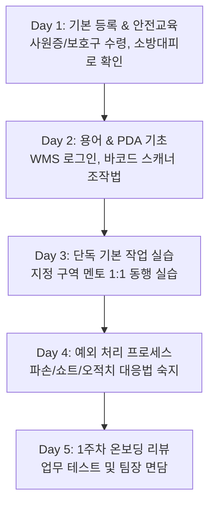

# [온보딩 07] 근무 가이드 및 신규 입사자 FAQ

> **안정적인 정착을 위한 안내**: 센터 생활 중 필요한 인사/근태 규정, 복리후생, 편의시설 정보 및 자주 묻는 질문을 정리했습니다.

---

## 1. 근태 관리 및 출퇴근 규정

### 1) 출퇴근 체크 (Time & Attendance)
- **체크 방법**: 센터 1층 로비의 키오스크에 사원증 태그 또는 생체인식(지문/안면)을 통해 출퇴근을 기록합니다.
- **출근 시간 엄수**: 업무 시작 최소 **10분 전**까지 출근 등록 및 개인보호구 착용을 완료하고 조회 장소에 집결해야 합니다.
- **지각 / 조퇴 / 결근 신청**:
  - 부득이한 사정으로 지각 또는 결근 시 업무 시작 **최소 1시간 전**에 소속 조장 또는 인사담당자에게 유선 통보해야 합니다.
  - 모바일 근태 앱을 통해 사후 24시간 이내에 증빙 서류(진료확인서 등)와 함께 휴가 신청서를 제출합니다.

### 2) 연장 및 특근(OT: Overtime)
- 물량 급증 시 당일 연장근무가 발생할 수 있으며, 연장 전 동의서 작성 또는 안내 방송을 통해 진행됩니다.
- 법정 연장·야간·휴일 근로 수당은 근로기준법에 따라 가산(1.5배) 지급됩니다.

---

## 2. 사내 편의시설 및 이용 안내

| 시설명 | 위치 | 운영 시간 | 이용 수칙 |
| :--- | :--- | :--- | :--- |
| **구내식당** | 지원동 2층 | 조식: 07:00~08:00 중식: 11:30~13:30 석식: 17:30~19:00 야식: 01:30~03:00 | 배식구 입장 시 사원증 바코드 스캔 (식권 불필요) |
| **휴게실 (남/여 분리)** | 물류동 2층 동편 | 24시간 개방 | 안마의자, 수면용 리클라이너 구비 (대화 자제, 정숙 유지) |
| **개인 락커룸** | 물류동 1층 중앙 | 상시 | 개인 배정된 락커만 사용, 귀중품 분실 주의 (자물쇠 지급) |
| **보건관리실** | 지원동 1층 | 09:00 ~ 21:00 (전담 간호사) | 두통약, 파스, 외상 치료제 구비, 혈압 측정 가능 |
| **지정 흡연구역** | 야외 주차장 뒤편 1개소 | 상시 | 센터 건물 내부 및 도크 구역 전체는 **절대 금연구역** (적발 시 퇴사 조치) |

---

## 3. 신규 입사자 FAQ (자주 묻는 질문)

### Q1. 안전화가 발에 맞지 않아 아픕니다. 교환이 가능한가요?
> **A.** 네, 가능합니다. 입사 첫 주 이내에 안전관리팀(물류동 1층)을 방문하시면 사이즈 교환 또는 발볼이 넓은 와이드 모델로 교환해 드립니다. 개인 소장 산업안전보건공단 인증(KCs 마크) 안전화 착용도 가능합니다.

### Q2. 작업 중 실수로 바코드를 잘못 찍거나 상품을 떨어뜨려 파손되었습니다. 변상해야 하나요?
> **A.** 고의적인 파손이 아니라면 개인에게 변상 책임을 묻지 않습니다. 중요한 것은 **'숨기지 않고 즉시 보고'**하는 것입니다. 상품 파손 시 조장에게 알리고 WMS에서 [파손 격리] 처리를 해야 전산 재고 오차를 막을 수 있습니다.

### Q3. 개인 스마트폰을 작업장에 가지고 들어갈 수 없나요?
> **A.** 안전사고 예방과 보안 유지를 위해 작업 현장 내 스마트폰 반입은 원칙적으로 금지됩니다. 락커룸에 보관해 주시기 바라며, 긴급한 가족 연락 등이 필요한 경우 현장 관리자(조장/반장) 번호를 비상 연락망으로 가족에게 공유해 주시기 바랍니다.

### Q4. 첫 급여 지급일과 정산 기준은 어떻게 되나요?
> **A.** 급여일은 **매월 10일**입니다. 전월 1일 ~ 말일까지의 기본급, 연장수당, 주휴수당 등이 합산되어 본인 명의 계좌로 입금됩니다 (10일이 공휴일인 경우 전일 지급).

### Q5. 몸이 갑자기 안 좋거나 다쳤을 때는 어떻게 하나요?
> **A.** 즉시 작업을 중단하고 주변 동료나 조장에게 알리십시오. 경미한 통증/찰과상은 지원동 1층 보건관리실에서 처치를 받을 수 있으며, 병원 진료가 필요한 경우 회사 지정 병원으로 신속 이송 지원됩니다.

---

## 4. 온보딩 1주차 적응 체크리스트

신규 입사자는 첫 일주일 동안 아래 사항을 단계별로 완료하고 멘토(담당 조장)의 확인을 받습니다.

- [ ] **Day 1**: 사원증 발급, 안전화/조끼 수령, 화재 대피로 및 집결지 확인 완료
- [ ] **Day 2**: WMS 계정 생성, PDA 기본 스캔 실습, 로케이션 주소 체계 이해
- [ ] **Day 3**: 담당 공정(IB, OB, ICQA 중 택1) 표준 작업 50건 이상 실습
- [ ] **Day 4**: 파손품 처리 기준, 비상정지(E-STOP) 버튼 위치 숙지
- [ ] **Day 5**: 1주차 적응 면담 진행 및 온보딩 피드백 제출

---

## 5. 사내 주요 연락망

- **인사지원팀 (근태/급여/복리후생)**: 02-XXX-2101 (`hr_logis@company.com`)
- **안전보건팀 (보건실/사고접수)**: 02-XXX-2109
- **고충처리상담센터 (익명 건의/직장 내 괴롭힘 상담)**: 080-XXX-0112
- **현장 운영지원 데스크**: 물류동 1층 중앙 통제실 (내선 1000)
